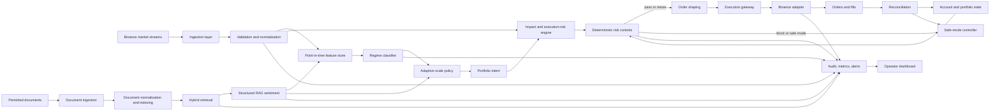
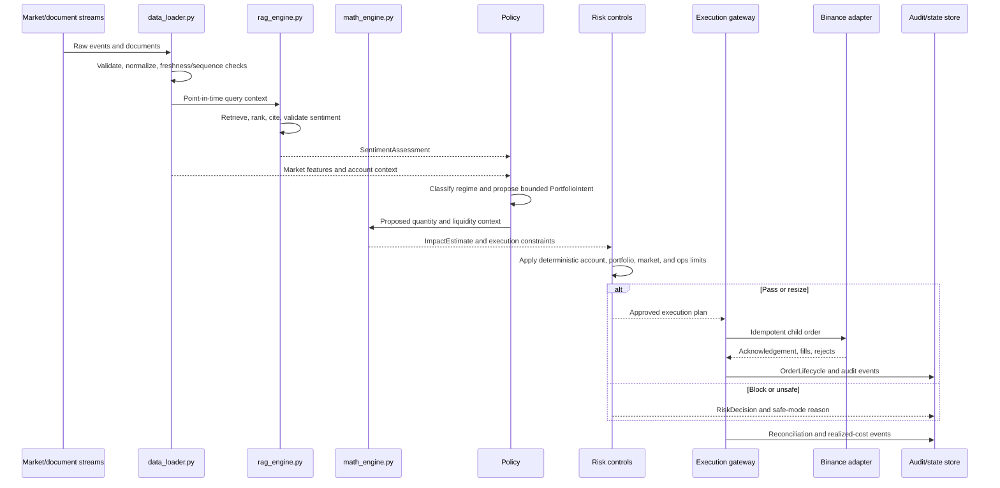
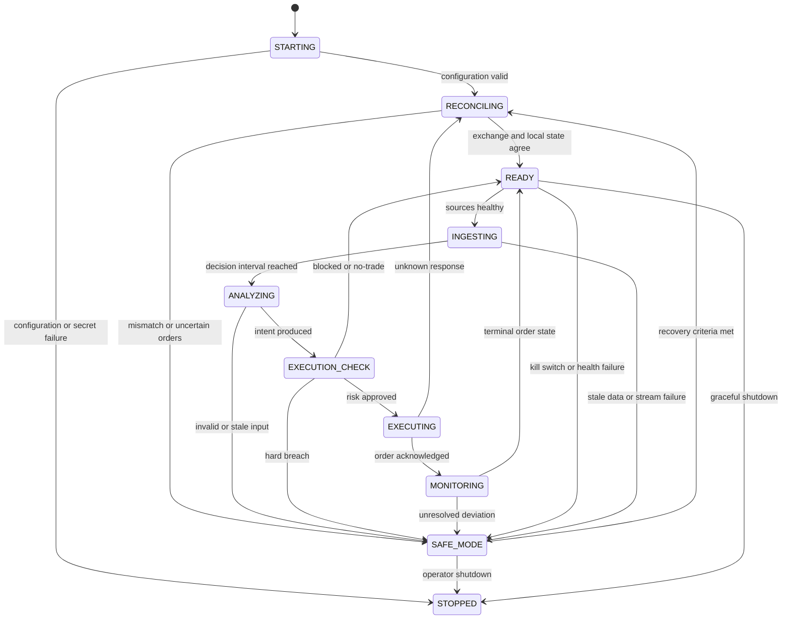

# Agentic-QuantRAG-Binance Architecture

**Status:** Production-ready architectural baseline  
**Version:** 1.0  
**Date:** 2026-10-17  
**Source of truth:** [PRD.md](./PRD.md)

## 1. Architecture Overview

Agentic-QuantRAG-Binance is a fail-closed, event-driven Python system. It transforms Binance market data and permitted external documents into evidence-backed sentiment, regime assessments, bounded portfolio intent, and risk-checked execution plans.

The architecture deliberately separates:

1. **Research and inference:** retrieval, sentiment, features, and regime classification.
2. **Decision policy:** conversion of signals into bounded target risk.
3. **Execution risk:** impact estimation, order shaping, and cost controls.
4. **Safety boundary:** deterministic pre-trade checks, exchange adapter, reconciliation, and kill switches.

An LLM or autonomous agent may request analysis and propose intent, but it can never submit an exchange order, modify risk limits, disable monitoring, or bypass the deterministic safety boundary.

### 1.1 Architectural principles

- **Point-in-time correctness:** every feature and decision uses only data available at decision time.
- **Evidence before inference:** sentiment includes source citations, timestamps, retrieval scores, and model versions.
- **Risk before action:** no order is sent before impact, account, portfolio, market, operational, and exchange checks pass.
- **Fail closed:** stale data, invalid model output, uncertain order state, and reconciliation mismatches stop new risk.
- **Immutable audit trail:** inputs, versions, decisions, checks, exchange responses, and operator actions are append-only events.
- **Deterministic execution boundary:** policy and execution constraints are reproducible without an LLM.
- **Environment isolation:** replay, paper, testnet, and live modes have separate configuration and credentials.

## 2. System Context

### 2.1 External systems

| External system | Direction | Purpose | Failure behavior |
|---|---|---|---|
| Binance WebSocket/API | Inbound and outbound | Market data, account state, orders, fills | Stop new risk; reconcile before resume |
| News and permitted document sources | Inbound | RAG sentiment evidence | Reduce confidence or abstain |
| Embedding/LLM provider | Outbound from RAG service | Retrieval embeddings and structured sentiment | Use cached evidence or no-trade |
| Vector/lexical index | Read/write | Hybrid document retrieval | Sentiment becomes unavailable |
| Time-series/event store | Read/write | Market data, features, outcomes, audit events | Halt if point-in-time state cannot be trusted |
| Secrets manager | Read | API credentials and provider secrets | Do not start live components |
| Metrics and alerting system | Outbound | Operational health and risk alerts | Continue only if local safety logging remains available |
| Operator dashboard | Read and control | Visibility, acknowledgements, kill switch | Local kill switch remains authoritative |

### 2.2 Deployment modes

| Mode | Exchange actions | Credentials | Primary purpose |
|---|---|---|---|
| `replay` | None | None | Deterministic historical research and failure testing |
| `paper` | Simulated only | No trading key | End-to-end validation against live or replay streams |
| `testnet` | Testnet only | Isolated testnet key | Adapter and lifecycle testing |
| `live` | Production Binance | Least-privilege production key | Controlled pilot after promotion gates |
| `safe` | Reduce-only/close-only if explicitly allowed | Existing mode credentials | Contain risk during incidents |

The mode is immutable for a running process. Changing mode requires a restart, validated configuration, and reconciliation before processing new decisions.

## 3. High-Level System Workflow



### 3.1 Decision sequence



## 4. Complete Directory Tree

The following tree is the intended repository layout. Empty directories should contain a `.gitkeep` until implementation files are added.

```text
Agentic-QuantRAG-Binance/
├── README.md
├── PRD.md
├── Architecture.md
├── pyproject.toml
├── uv.lock                              # or an equivalent locked dependency file
├── .env.example
├── .gitignore
├── Makefile                             # optional Windows-compatible task aliases
├── configs/
│   ├── base.yaml                        # shared validated defaults
│   ├── replay.yaml                      # no exchange side effects
│   ├── paper.yaml                       # simulated execution
│   ├── testnet.yaml                     # isolated testnet settings
│   ├── live.example.yaml                # safe template; no secrets
│   ├── symbols.yaml                     # approved symbols and exchange filters
│   ├── risk_limits.yaml                 # reviewed deterministic limits
│   └── model_registry.yaml              # approved model/index/prompt versions
├── data/
│   ├── raw/                             # immutable, partitioned input events
│   ├── normalized/                       # canonical market and document records
│   ├── features/                         # point-in-time feature snapshots
│   ├── labels/                           # reviewed sentiment/regime labels
│   ├── replays/                          # deterministic replay fixtures
│   └── reports/                          # generated research and cost reports
├── notebooks/
│   ├── 01_data_quality.ipynb
│   ├── 02_sentiment_evaluation.ipynb
│   ├── 03_regime_evaluation.ipynb
│   ├── 04_impact_calibration.ipynb
│   └── 05_replay_analysis.ipynb
├── src/
│   ├── __init__.py
│   ├── main.py                           # process entry point and lifecycle
│   ├── data_loader.py                    # market/document ingestion facade
│   ├── math_engine.py                    # features, regimes, impact mathematics
│   ├── rag_engine.py                     # retrieval and structured sentiment
│   ├── config/
│   │   ├── __init__.py
│   │   ├── loader.py                     # environment config and validation
│   │   └── models.py                     # typed configuration models
│   ├── domain/
│   │   ├── __init__.py
│   │   ├── enums.py                      # modes, regimes, statuses, reason codes
│   │   ├── events.py                     # canonical event schemas
│   │   ├── market.py                     # MarketEvent and market snapshots
│   │   ├── documents.py                  # Document and RetrievalEvidence
│   │   ├── decisions.py                  # sentiment, regime, intent, risk
│   │   └── orders.py                     # order lifecycle and fill schemas
│   ├── ingestion/
│   │   ├── __init__.py
│   │   ├── binance_market.py             # WebSocket market streams
│   │   ├── binance_account.py            # balances, positions, open orders
│   │   ├── document_sources.py           # permitted news/document connectors
│   │   ├── replay_source.py              # deterministic event playback
│   │   └── quality.py                    # duplicates, gaps, freshness, skew
│   ├── normalization/
│   │   ├── __init__.py
│   │   ├── market.py                     # raw exchange to canonical records
│   │   ├── documents.py                  # text hash, timestamps, entities
│   │   └── point_in_time.py              # as-of joins and leakage guards
│   ├── retrieval/
│   │   ├── __init__.py
│   │   ├── chunker.py                    # stable chunks and metadata
│   │   ├── index.py                      # vector and lexical index adapters
│   │   ├── retriever.py                  # hybrid retrieval and reranking
│   │   └── safety.py                     # injection, duplication, source checks
│   ├── sentiment/
│   │   ├── __init__.py
│   │   ├── schemas.py                    # strict structured output schema
│   │   ├── infer.py                      # provider-independent inference
│   │   ├── validate.py                   # citations, ranges, contradictions
│   │   └── calibration.py                # confidence and abstention checks
│   ├── features/
│   │   ├── __init__.py
│   │   ├── market.py                     # returns, volatility, momentum
│   │   ├── liquidity.py                  # spread, depth, volume, imbalance
│   │   ├── sentiment.py                  # aggregate point-in-time sentiment
│   │   └── builder.py                    # versioned feature vector assembly
│   ├── regimes/
│   │   ├── __init__.py
│   │   ├── taxonomy.py                   # supported regime definitions
│   │   ├── rules.py                      # interpretable baseline
│   │   ├── classifier.py                 # learned classifier interface
│   │   └── hysteresis.py                 # persistence and transition logic
│   ├── policy/
│   │   ├── __init__.py
│   │   ├── scale_policy.py               # bounded target-risk policy
│   │   ├── portfolio.py                  # exposure and target position
│   │   └── reason_codes.py               # explainable policy decisions
│   ├── execution/
│   │   ├── __init__.py
│   │   ├── impact.py                     # Square Root Market Impact Law
│   │   ├── cost_model.py                 # fees, spread, delay, shortfall
│   │   ├── order_shaper.py               # child orders and schedules
│   │   ├── gateway.py                   # approval-to-order boundary
│   │   ├── binance_adapter.py            # exchange-specific implementation
│   │   └── idempotency.py                # client IDs and safe retries
│   ├── risk/
│   │   ├── __init__.py
│   │   ├── pre_trade.py                  # deterministic checks
│   │   ├── post_trade.py                 # fill/slippage/limit checks
│   │   ├── limits.py                     # typed limit definitions
│   │   ├── kill_switch.py                # global/per-symbol controls
│   │   └── safe_mode.py                  # transitions and recovery gates
│   ├── state/
│   │   ├── __init__.py
│   │   ├── store.py                      # durable state interface
│   │   ├── machine.py                    # process state machine
│   │   └── reconciliation.py             # exchange/local state comparison
│   ├── orchestration/
│   │   ├── __init__.py
│   │   ├── scheduler.py                  # periodic workflows
│   │   ├── agent.py                      # constrained agent coordination
│   │   └── commands.py                   # approved operator commands
│   ├── observability/
│   │   ├── __init__.py
│   │   ├── audit.py                      # append-only decision events
│   │   ├── metrics.py                    # latency, risk, quality metrics
│   │   ├── alerts.py                     # operational and risk alerts
│   │   └── health.py                     # readiness and liveness checks
│   └── storage/
│       ├── __init__.py
│       ├── event_store.py                # raw and audit persistence
│       ├── feature_store.py              # as-of feature retrieval
│       └── outcome_store.py              # realized cost and PnL outcomes
├── tests/
│   ├── conftest.py
│   ├── fixtures/
│   ├── unit/
│   │   ├── test_data_loader.py
│   │   ├── test_math_engine.py
│   │   ├── test_rag_engine.py
│   │   ├── test_risk_controls.py
│   │   └── test_state_machine.py
│   ├── integration/
│   │   ├── test_pipeline.py
│   │   ├── test_exchange_adapter.py
│   │   └── test_reconciliation.py
│   ├── replay/
│   │   ├── test_deterministic_replay.py
│   │   ├── test_impact_attribution.py
│   │   └── test_failure_injection.py
│   └── security/
│       ├── test_prompt_injection.py
│       ├── test_secret_redaction.py
│       └── test_permission_boundaries.py
├── scripts/
│   ├── run_replay.py
│   ├── run_paper.py
│   ├── calibrate_impact.py
│   ├── build_retrieval_index.py
│   └── generate_report.py
├── docs/
│   ├── runbook.md
│   ├── model-card.md
│   ├── incident-response.md
│   └── promotion-checklist.md
└── .github/
    └── workflows/
        ├── ci.yml
        └── security.yml
```

## 5. Component Responsibilities and Interactions

### 5.1 Required top-level Python modules

#### `src/data_loader.py`

The ingestion facade owns source adapters and produces validated canonical events. It must:

- expose one interface for live Binance streams, documents, and deterministic replay;
- normalize all timestamps to UTC while retaining source and receive times;
- enforce sequence, duplicate, gap, freshness, and clock-skew checks;
- emit `MarketEvent`, `Document`, `AccountSnapshot`, and `DataQualityEvent`;
- never silently repair malformed data;
- apply bounded queues and backpressure;
- publish readiness only when configured sources are healthy.

It must not calculate trading intent or send orders.

#### `src/math_engine.py`

The quantitative computation facade owns:

- returns, realized volatility, volatility-of-volatility, momentum, and autocorrelation;
- spread, depth, volume anomaly, participation, and imbalance features;
- regime probabilities through rule or classifier implementations;
- Square Root Market Impact Law:

  \[
  I(Q) = Y \cdot \sigma \cdot (Q/V)^\alpha
  \]

- expected shortfall, fees, spread, delay allowance, and conservative bounds;
- realized-cost attribution after fills.

The module must accept explicit as-of timestamps and versioned parameters. It must reject invalid units, non-positive volume, stale context, and out-of-range participation.

#### `src/rag_engine.py`

The RAG facade owns:

- document chunking and stable identifiers;
- hybrid lexical/vector retrieval;
- recency, source-quality, and diversity weighting;
- prompt construction with untrusted-content isolation;
- structured sentiment inference;
- citation, range, contradiction, novelty, and confidence validation;
- abstention when evidence is absent, stale, conflicting, or invalid.

It must return `SentimentAssessment` plus `RetrievalEvidence`, not an unstructured trade instruction. It must not access exchange credentials or call the order gateway.

#### `src/main.py`

The process entry point owns lifecycle orchestration:

1. load and validate configuration;
2. initialize logging, state store, source adapters, and health checks;
3. restore and reconcile state;
4. select the mode-specific runner;
5. run the bounded online decision loop;
6. route all proposed orders through impact and risk controls;
7. flush audit events and close adapters on shutdown.

`main.py` should wire components, not contain model logic, exchange-specific logic, or business rules.

### 5.2 Component interaction contracts

| Producer | Consumer | Contract | Required guarantees |
|---|---|---|---|
| `data_loader` | normalization | Raw source event | Source timestamp, receive timestamp, source ID |
| normalization | feature builder | Canonical market snapshot | UTC, schema-valid, point-in-time |
| document pipeline | `rag_engine` | Retrieved evidence | Stable chunk IDs, scores, source metadata |
| `rag_engine` | feature builder/policy | `SentimentAssessment` | Citations, confidence, version, abstention state |
| feature builder | regime classifier | Versioned feature vector | As-of timestamp, no future values |
| regime classifier | scale policy | `RegimeAssessment` | Probabilities, selected regime, uncertainty |
| scale policy | impact engine | `PortfolioIntent` | Bounded target, expiry, rationale |
| impact engine | risk controls | `ImpactEstimate` | Participation, expected impact, confidence/bounds |
| risk controls | gateway | `ApprovedExecutionPlan` | Passed checks, limits snapshot, expiry |
| gateway | exchange adapter | `OrderCommand` | Idempotency key, price/size constraints |
| exchange adapter | state/reconciliation | `OrderLifecycle` | Exchange IDs, status transitions, fills |
| all components | audit/metrics | Structured events | Correlation ID, versions, timestamps |

## 6. Data Streams and Flow

### 6.1 Market-data stream

```text
Binance WebSocket/API
    -> raw market event
    -> sequence and timestamp validation
    -> canonical MarketEvent
    -> rolling market snapshot
    -> point-in-time features
    -> regime and impact inputs
```

Required fields include symbol, event type, event time, receive time, price/quantity fields, sequence metadata, source, and schema version.

### 6.2 Document and sentiment stream

```text
Permitted source
    -> immutable Document
    -> deduplication and text hash
    -> chunking with stable IDs
    -> vector + lexical indexing
    -> hybrid retrieval
    -> evidence validation
    -> structured SentimentAssessment
    -> point-in-time sentiment aggregate
```

The stream preserves publication time separately from ingestion time. A document received late cannot be used in a historical decision before its publication/availability timestamp.

### 6.3 Decision stream

```text
MarketSnapshot + SentimentAggregate + AccountSnapshot
    -> FeatureVector
    -> RegimeAssessment
    -> PortfolioIntent
    -> ImpactEstimate
    -> RiskDecision
    -> ApprovedExecutionPlan | BlockedDecision
```

Each decision carries a `decision_id` and `correlation_id` that remain constant across policy, risk, order, fill, and post-trade events.

### 6.4 Order and fill stream

```text
ApprovedExecutionPlan
    -> child OrderCommand
    -> exchange acknowledgement
    -> partial/full fills or rejection
    -> OrderLifecycle
    -> position/account update
    -> reconciliation
    -> realized-cost attribution
```

Unknown exchange responses are not treated as rejected. The adapter must query/reconcile the exchange using the client-order ID before any retry or replacement.

### 6.5 Audit and observability stream

All streams emit structured events to the audit layer:

```text
source health, data quality, retrieval, sentiment, features, regime,
policy, impact, risk, order, fill, reconciliation, safe-mode, operator action
```

Every event includes `event_id`, `event_time`, `process_time`, `correlation_id`, `decision_id` where applicable, component, schema version, environment mode, and relevant model/configuration versions.

## 7. System State Management

### 7.1 State ownership

| State category | Owner | Durability | Mutability |
|---|---|---|---|
| Process lifecycle | `state.machine` | Durable checkpoint plus logs | Controlled transitions only |
| Market snapshot | `data_loader`/feature store | Reconstructible and persisted | Replaced by newer valid event |
| RAG index metadata | retrieval layer | Durable | Versioned, never silently replaced |
| Sentiment and regime assessments | decision store | Append-only | New assessment supersedes by timestamp |
| Portfolio/account state | reconciliation layer | Durable checkpoint | Exchange is source of truth after reconciliation |
| Risk limits | config/risk layer | Versioned configuration | Not mutable by agents at runtime |
| Order lifecycle | execution gateway | Append-only event log | State transitions are validated |
| Kill switches | risk/operator control | Durable and fail-safe | Explicit operator/system action |
| Metrics and health | observability | Time-series retention | Append-only measurements |

### 7.2 Core process state machine



### 7.3 System state variables

| Variable | Type | Scope | Meaning | Update rule |
|---|---|---|---|---|
| `run_id` | UUID | Process | Unique process execution identifier | Created at startup; immutable |
| `environment_mode` | Enum | Process | `replay`, `paper`, `testnet`, `live`, or `safe` | Config-only; immutable while running |
| `lifecycle_state` | Enum | Process | Current state-machine state | Validated transitions only |
| `config_version` | String | Process | Hash/version of loaded configuration | Immutable for a run |
| `code_version` | String | Process | Build or source revision | Immutable for a run |
| `last_heartbeat_at` | UTC timestamp | Process | Last healthy loop heartbeat | Updated by supervisor |
| `kill_switch_global` | Boolean | Risk | Blocks all new risk when true | Operator/system action; fail-safe |
| `kill_switch_symbols` | Set[symbol] | Risk | Symbols blocked from new risk | Explicit add/remove with audit event |
| `reduce_only_mode` | Boolean | Risk | Allows only position-reducing orders | Enabled by safe mode or operator |
| `source_health` | Map[source, status] | Ingestion | Connectivity, freshness, and error state | Updated per source event/check |
| `last_market_event_at` | Map[symbol, UTC] | Market | Most recent valid market event | Updated only after validation |
| `market_sequence` | Map[source, integer] | Market | Last accepted source sequence | Must increase or follow documented reset |
| `market_data_fresh` | Map[symbol, Boolean] | Market | Whether data is inside freshness SLA | Derived from current time and timestamp |
| `document_watermark` | Map[source, UTC] | Documents | Latest safely ingested document time | Monotonic per source |
| `retrieval_index_version` | String | RAG | Active embedding/index version | Config-selected and audited |
| `sentiment_model_version` | String | RAG | Active inference model/prompt version | Config-selected and audited |
| `last_sentiment` | Map[asset, assessment] | Decision | Latest valid sentiment assessment | Append-only history; latest pointer |
| `sentiment_confidence` | Map[asset, float] | Decision | Confidence in `[0, 1]` | Validated before use |
| `sentiment_staleness` | Map[asset, duration] | Decision | Age of latest usable sentiment | Derived; lowers scale when stale |
| `feature_vector_version` | String | Features | Feature schema and implementation version | Stored with every vector |
| `last_regime` | Map[asset, regime] | Regime | Previous selected regime | Used for hysteresis |
| `regime_probabilities` | Map[asset, distribution] | Regime | Probability per regime | Replaced per valid assessment |
| `regime_uncertainty` | Map[asset, float] | Regime | Classifier uncertainty/unknown score | High uncertainty reduces risk |
| `regime_dwell_started_at` | Map[asset, UTC] | Regime | Start of current stable regime | Updated after accepted transition |
| `policy_version` | String | Policy | Active scale-policy version | Config-selected and audited |
| `target_position` | Map[asset, quantity] | Portfolio | Desired bounded position | Produced by policy; never sent directly |
| `current_position` | Map[asset, quantity] | Portfolio | Reconciled exchange position | Exchange truth after reconciliation |
| `gross_exposure` | Decimal | Portfolio | Total absolute exposure | Derived from reconciled positions |
| `net_exposure` | Decimal | Portfolio | Signed portfolio exposure | Derived from reconciled positions |
| `available_risk_budget` | Decimal | Portfolio | Remaining configured risk capacity | Recomputed after fills and PnL |
| `realized_pnl` | Decimal | Account | Realized PnL for configured period | Reconciled/calculated |
| `unrealized_pnl` | Decimal | Account | Mark-to-market PnL | Recomputed from valid prices |
| `drawdown` | Decimal | Account | Current drawdown from configured high-water mark | Updates on valuation |
| `impact_model_version` | String | Execution | Active `Y`, `alpha`, and calibration version | Config-selected and audited |
| `impact_coefficient_y` | Decimal | Execution | Calibrated impact coefficient | Read-only runtime parameter |
| `impact_exponent_alpha` | Decimal | Execution | Calibrated participation exponent | Read-only runtime parameter |
| `reference_volume` | Decimal | Execution | Volume used by impact calculation | Point-in-time input |
| `participation_rate` | Decimal | Execution | Proposed quantity/reference volume | Must remain under limit |
| `expected_impact_bps` | Decimal | Execution | Estimated market impact | Blocks/resizes when over budget |
| `expected_shortfall_bps` | Decimal | Execution | Fees + spread + impact + delay | Compared with cost budget |
| `risk_limits_version` | String | Risk | Version of active limits | Stored on every decision |
| `last_risk_decision` | RiskDecision | Risk | Most recent pass/block/resize result | Append-only history and pointer |
| `consecutive_rejections` | Map[asset, integer] | Risk | Rejected-order count | Resets only after valid terminal success |
| `decision_id` | UUID | Decision | Identity of one policy/risk decision | Created per decision cycle |
| `correlation_id` | UUID | Trace | End-to-end trace identity | Propagated across all events |
| `client_order_id` | String | Orders | Idempotent local order identity | Unique and immutable |
| `open_orders` | Map[id, lifecycle] | Orders | Non-terminal orders known locally | Reconciled with exchange |
| `unknown_orders` | Set[id] | Orders | Orders with uncertain exchange outcome | Blocks retry/replacement until resolved |
| `order_state` | Enum | Orders | New, acknowledged, partially filled, filled, canceled, rejected, unknown | Validated state transitions |
| `last_fill_at` | Map[asset, UTC] | Orders | Most recent accepted fill time | Used for monitoring and cooldown |
| `reconciliation_status` | Enum | Operations | Healthy, pending, mismatch, failed | Mismatch enters safe mode |
| `last_reconciled_at` | UTC timestamp | Operations | Last successful exchange reconciliation | Must remain inside SLA |
| `safe_mode_reason` | Enum/list | Operations | Why safe mode was entered | Immutable incident record |
| `safe_mode_entered_at` | UTC timestamp | Operations | Start of safe mode | Used for recovery and alerting |
| `safe_mode_recovery_checks` | Map[check, Boolean] | Operations | Required recovery criteria | Must all pass before resume |
| `last_audit_event_id` | UUID | Audit | Last durable audit event | Checkpoint for restart/recovery |

### 7.4 State transition rules

- State is written only through typed commands or validated events.
- Derived values such as exposure, participation, and freshness are recomputed from authoritative inputs; they are not trusted from agent output.
- Exchange positions and order statuses become authoritative after reconciliation.
- An unknown order state blocks retries, replacement orders, and shutdown completion until resolved or explicitly escalated.
- Agents cannot mutate `risk_limits_version`, kill switches, credentials, environment mode, or safe-mode recovery gates.
- Any state-changing operator action produces an audit event with actor, reason, previous value, new value, and timestamp.

## 8. Safe Mode and Failure Handling

### 8.1 Safe-mode triggers

The system enters `SAFE_MODE` on:

- stale or incomplete market data beyond the configured SLA;
- source sequence gaps that cannot be recovered;
- unavailable or contradictory RAG evidence where a decision requires sentiment;
- invalid model output or missing citations;
- impact estimate outside calibrated bounds or over the configured budget;
- daily loss, drawdown, exposure, leverage, or concentration breach;
- exchange disconnect, authentication failure, rate-limit exhaustion, or unknown order response;
- local/exchange reconciliation mismatch;
- missing audit persistence or unhealthy critical dependencies;
- global or symbol-specific kill switch activation.

### 8.2 Recovery sequence

```text
Trigger incident
    -> stop new/increasing risk
    -> cancel or reduce working orders per policy
    -> alert operator
    -> persist reason and state snapshot
    -> restore source connectivity
    -> reconcile balances, positions, and orders
    -> validate freshness and risk budgets
    -> clear only resolved triggers
    -> require operator approval where configured
    -> resume in paper/safe mode or return to READY
```

## 9. Persistence and Event Schema

### 9.1 Event envelope

Every durable event should use an envelope equivalent to:

```json
{
  "event_id": "uuid",
  "event_type": "risk.decision",
  "event_time": "UTC timestamp",
  "process_time": "UTC timestamp",
  "run_id": "uuid",
  "correlation_id": "uuid",
  "decision_id": "uuid",
  "environment_mode": "paper",
  "component": "risk.pre_trade",
  "schema_version": "1.0",
  "config_version": "sha256",
  "payload": {}
}
```

Sensitive values must be redacted before persistence. API keys, secrets, and unrestricted account credentials must never appear in payloads.

### 9.2 Restart and replay guarantees

- The system checkpoints the last durable audit event and source offsets where supported.
- On restart, it loads configuration, validates compatibility, restores non-authoritative state, and reconciles exchange state.
- Replay uses the same canonical schemas and decision functions as online execution.
- Replaying the same input events with the same versions must produce the same policy, impact, and risk outputs, excluding explicitly nondeterministic provider calls.
- Provider responses used in research are cached with request, model, prompt, retrieval, and response versions.

## 10. Testing and Validation Architecture

| Test layer | Scope | Required assertions |
|---|---|---|
| Unit | `data_loader.py`, `math_engine.py`, `rag_engine.py`, controls | Schema, formulas, bounds, citations, abstention, transitions |
| Integration | End-to-end component wiring | Correct contracts, persistence, metrics, and mode isolation |
| Replay | Historical deterministic stream | No leakage, reproducible outputs, realistic costs |
| Failure injection | Disconnects, stale data, unknown orders, gaps | Fail closed, safe-mode entry, recovery behavior |
| Security | Prompt injection, secrets, permissions | Untrusted content isolation and no credential leakage |
| Paper soak | Long-running simulated trading | Stability, queues, reconciliation, alerts, drawdown controls |

Promotion requires successful tests plus out-of-sample signal/regime evaluation, impact calibration, paper observation, and explicit risk-owner approval as specified in the PRD.

## 11. Operational Interfaces

### 11.1 Operator dashboard read model

The dashboard reads a safe, redacted projection containing:

- environment and lifecycle state;
- source freshness and health;
- regime probabilities and sentiment citations;
- account exposure, positions, open orders, drawdown, and risk budget;
- target versus executed scale;
- expected versus realized impact;
- blocked decisions and reason codes;
- kill-switch and safe-mode state;
- reconciliation status and last successful check.

### 11.2 Operator commands

Supported commands should be explicit, authenticated, audited, and idempotent:

- activate/deactivate global kill switch;
- activate/deactivate a symbol kill switch;
- request reduce-only mode;
- acknowledge an incident;
- request reconciliation;
- resume after recovery checks;
- shut down gracefully.

No operator command may silently alter model parameters, risk limits, credentials, or source code.

## 12. Architecture Definition of Done

The architecture is implemented when:

- the directory boundaries and required top-level modules exist;
- the four required modules (`data_loader.py`, `math_engine.py`, `rag_engine.py`, `main.py`) expose typed interfaces;
- all decision streams carry correlation and version metadata;
- the online workflow is executable in replay and paper modes;
- policy, impact, and risk controls are deterministic and independently testable;
- safe-mode transitions and exchange reconciliation are implemented;
- state variables have durable ownership and restart semantics;
- audit, metrics, alerts, and dashboard projections are available;
- no agent or LLM can directly submit orders or alter safety controls;
- tests cover normal flow, blocked flow, failure flow, and deterministic replay.

